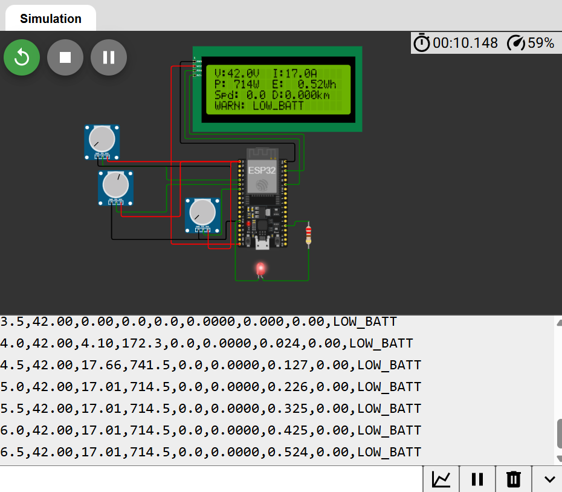

# ESP32 Energy Consumption Meter (Joulemeter) Simulation

A Wokwi simulation of an energy-monitoring node for an energy-efficient vehicle. An ESP32 reads simulated battery voltage, motor current, and vehicle speed, then computes real-time power, accumulated energy (Wh), distance, and energy efficiency (km/kWh). Results are shown on a 20x4 driver-dashboard LCD and streamed as CSV telemetry over serial, with safety alerts for over-current and low battery voltage.

**Live demo:** [Open the simulation in Wokwi](https://wokwi.com/projects/481637403573515265)



## Features

- Real-time power calculation from voltage and current
- Accumulated energy (Wh) and distance (km) integrated over time
- Energy efficiency in km/kWh, the key metric of energy-efficient vehicle competitions
- 20x4 I2C LCD driver dashboard (voltage, current, power, energy, speed, distance, efficiency)
- CSV telemetry output over serial at 115200 baud, ready for logging or plotting
- Safety alerts: over-current and low battery voltage, with a warning LED and a dashboard message

## How It Works

Every 500 ms the firmware measures the real elapsed time (`dt`) with `millis()`, reads the three analog inputs, and updates the totals:

| Quantity | Formula |
|---|---|
| Power | `P = V × I` (W) |
| Energy | `E += P × dt / 3600` (Wh) |
| Distance | `D += v × dt / 3600` (km) |
| Efficiency | `η = D / (E / 1000)` (km/kWh) |

The efficiency is only computed once the accumulated energy is above a small threshold, which avoids a division by zero at startup.

## Simulated Hardware

| Component | Role | Pin |
|---|---|---|
| ESP32 DevKit | Microcontroller | n/a |
| Potentiometer 1 | Battery voltage | GPIO 34 (ADC1) |
| Potentiometer 2 | Motor current | GPIO 35 (ADC1) |
| Potentiometer 3 | Vehicle speed | GPIO 32 (ADC1) |
| LED with series resistor | Warning indicator | GPIO 2 |
| 20x4 I2C LCD (address `0x27`) | Driver dashboard | Default I2C pins (SDA 21, SCL 22) |

ADC1 pins are used for the analog inputs. The 12-bit ADC value (0-4095) is mapped linearly to the physical range of each signal:

| Signal | Range | Note |
|---|---|---|
| Voltage | 42.0 - 54.6 V | Range of a 13S Li-ion battery pack |
| Current | 0 - 30 A | Motor current |
| Speed | 0 - 50 km/h | Vehicle speed |

## Alert Logic

| Condition | Status | Behavior |
|---|---|---|
| Current > 25 A | `OVER_CURR` | Warning LED on, LCD shows the warning |
| Voltage < 43.5 V | `LOW_BATT` | Warning LED on, LCD shows the warning |
| Otherwise | `OK` | Warning LED off, LCD shows efficiency |

If both conditions are true at the same time, `OVER_CURR` takes priority.

## Serial Telemetry Format

The first line is a CSV header, followed by one row every 500 ms:

```
Time_s,Voltage_V,Current_A,Power_W,Speed_kmh,Distance_km,Energy_Wh,Efficiency_km_kWh,Status
```

Sample output from the simulation:

```
60.0,45.87,30.00,1376.0,0.0,0.1573,10.148,15.50,OVER_CURR
60.5,45.87,8.21,376.7,0.0,0.1573,10.201,15.42,OK
```

## How to Run

1. Open the live demo link above (or create a new ESP32 project at [wokwi.com](https://wokwi.com)).
2. Copy `sketch.ino`, `diagram.json`, and `libraries.txt` from this repository into the Wokwi project.
3. Click **Start the simulation**.
4. Turn the three potentiometers to change voltage, current, and speed, and watch the LCD and the serial monitor.

Required library: `LiquidCrystal I2C` (listed in `libraries.txt`).

## Limitations

- This is a simulation: potentiometers stand in for real sensors, and the ADC is treated as perfectly linear.
- A real build needs a voltage divider, a current sensor (shunt or Hall-effect), calibration, and signal filtering. The ESP32 ADC is also non-linear in practice.
- Energy is integrated at a fixed 500 ms interval, so fast current changes between samples are not captured.

## Future Work

- Replace the potentiometers with real voltage and current sensors, with calibration
- Estimate battery state of charge (SoC) from voltage and integrated energy
- Add a moving-average filter to the analog readings
- Log telemetry to an SD card or send it wirelessly using the ESP32's Wi-Fi/BLE

## Author

Naufal Aurelio Estiawan
School of Electrical Engineering & Informatics, Institut Teknologi Bandung (ITB)
[GitHub](https://github.com/NaufalAurelioE) | [LinkedIn](https://linkedin.com/in/naufal-aurelio-estiawan-299733434)
